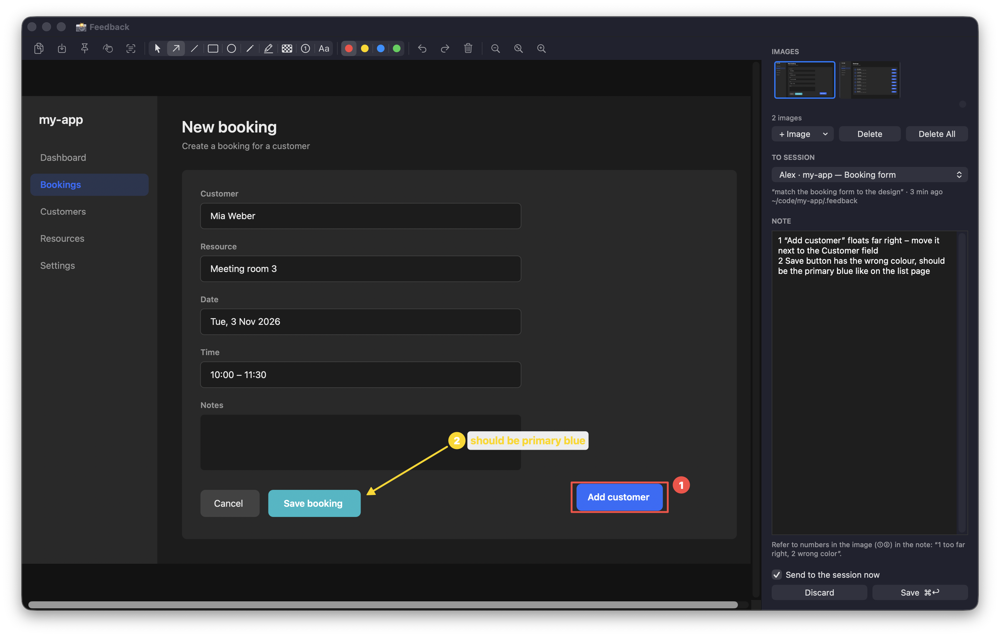
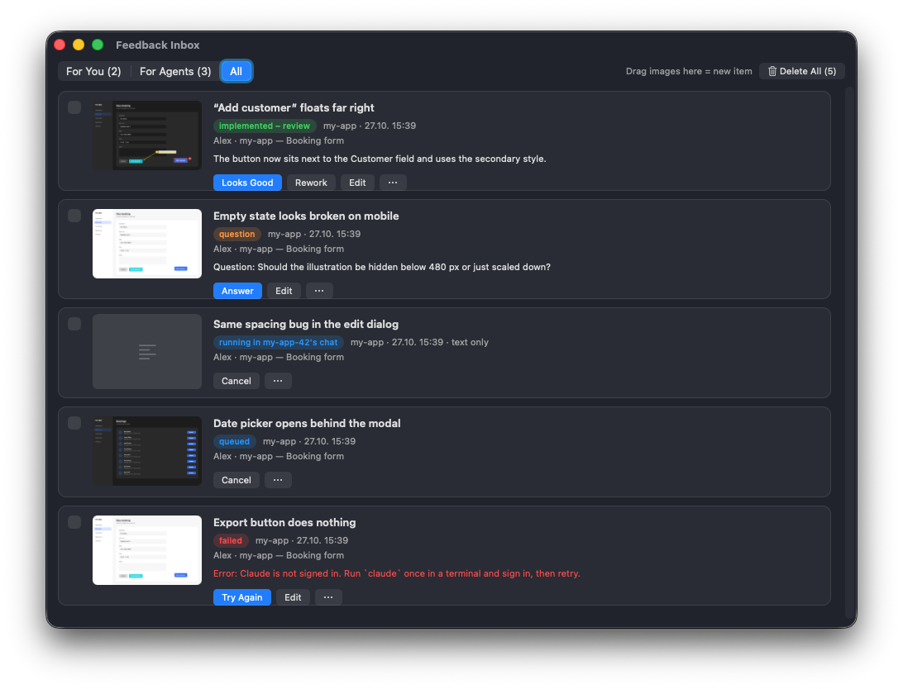

# agent-feedback

Give visual feedback to [Claude Code](https://claude.com/claude-code), [Codex](https://github.com/openai/codex) and [pi](https://pi.dev) sessions the way you would to a colleague: grab a screenshot, draw on it, write a note, hand it to a running session. The session picks it up in its chat, fixes exactly that, writes down what it changed, and you accept the result or send it back.

A small macOS menu bar app, three hooks and one skill. Everything is plain files: no server, no account, no database.





## What it does

**Capture**
- Global shortcuts (changeable in Settings, ⌘,): **⌃⌥S** area or window screenshot, **⌃⌥⇧S** full screen, **⌃⌥T** recognize text in an area and copy it (OCR). Alternatively: image from the clipboard, an image file, drag & drop, or a text-only item.
- Editor: toolbar with select/move/delete, arrow, line, box, ellipse, pen, highlighter, pixelate, numbered markers ①②③, text; undo/redo; zoom. Image actions (they close the editor without filing an item): copy (⌘C), save as PNG (⇧⌘S), pin on top, drag into other apps. Copy recognized text keeps it open. Several images per item, each with its own context (time, app, Chrome URL and tab title, window size, light/dark mode). Pick, delete or clear images in the thumbnail strip.
- Pick the target session from the sessions that are currently running (project, title, last prompt), write a note (“1 too far right, 2 wrong colour”), **⌘↩**.

**Hand-off**
- If the session is still running, the item lands **in its chat** as a message (Claude Code's local session messaging, sent by a short `claude -p --model haiku` call, model configurable with the `SendMessage` tool). You see it work and can step in.
- If the session has ended, a background fork of it (`claude -p --resume <id> --fork-session`) does the job with the same context. Without a known session, a fresh one starts in the project.
- One job at a time per feedback folder, so two agents never edit the same files at once. Waiting and running jobs can be cancelled; failed runs show a readable reason and can be retried.

**Review**
- The agent only ever reports *implemented*, *nothing to do* or a *question*. You check the result yourself and press **Looks Good** (accept) or **Rework** (send back with a note; screenshot and history stay attached).
- Questions are answered in a small dialog; “Continue Work” puts the item back in the queue.
- The **inbox** window lists every item from every known folder, also for sessions that have ended: preview, project, session, status, the agent's last change or question. Filter “for you” / “for agents” / “all”, reassign to another running session, edit again, delete one, a selection or everything (permanently, after a confirmation).
- The menu bar shows what needs attention: `📸 ⏳2 ❓1 ✅3` (waiting for agents, questions, to review).

## Requirements

- macOS 14.4 or later
- Xcode Command Line Tools (`swiftc`): `xcode-select --install`
- `jq`: `brew install jq`
- Claude Code CLI (`claude`), signed in. Delivery into a running chat needs a version with local session messaging (the `SendMessage` tool); otherwise items are worked on in the background.
- Optional: Codex CLI (`codex`) with hooks (0.114 or later).
- Optional: pi (`pi`).

## Install

With Homebrew:

```bash
brew install bendemartin97/tap/agent-feedback
brew services start agent-feedback   # menu bar app, also at login
agent-feedback setup --hooks         # links hooks and skill, adds the hook entries
```

From a checkout:

```bash
git clone https://github.com/bendemartin97/agent-feedback.git
cd agent-feedback
./install.sh --hooks
```

This builds `~/Applications/AgentFeedback.app`, starts it at login (LaunchAgent), links the hooks to `~/.claude/agent-feedback/bin/` and the skill to `~/.claude/skills/feedback`, and adds three hook entries to `~/.claude/settings.json` (a backup is written next to it). Without `--hooks` the entries are printed for you to add yourself.

On the first screenshot macOS asks for **Screen Recording**, on the first screenshot taken in Chrome for **Automation** (to read the tab URL). If a code-signing identity “Apple Development” exists, the app is signed with it so these permissions survive rebuilds; otherwise it is signed ad hoc and macOS may ask again after each build. Set `AGENT_FEEDBACK_BUNDLE_ID` for `build.sh`/`uninstall.sh` to use your own bundle identifier.

Sessions show up in the app once you have sent at least one prompt in them after installing.

### Codex

```bash
agent-feedback setup --codex   # or ./install.sh --codex
```

Links the skill to `~/.agents/skills/feedback` and adds the same hooks to `~/.codex/hooks.json` (backup next to it). Codex asks you to trust new hooks: run `/hooks` once in Codex and approve them. Codex sessions then show up in the picker with “(Codex)”. “Send to the session now” puts the item into an open Codex session with `codex queue` (no extra model call, no Claude subscription needed): it runs as the next turn, right away if the session is idle. Once the session has ended, a background fork works on it (`codex exec fork <session> …`, sandbox `workspace-write` plus the feedback folder).

### pi

```bash
agent-feedback setup --pi   # or ./install.sh --pi
```

Links the skill to `~/.agents/skills/feedback` and the extension `hooks/pi-extension.ts` to `~/.pi/agent/extensions/agent-feedback.ts` (pi has no hook config; the extension does what the hooks do). Restart running pi sessions or run `/reload`; interactive pi sessions then show up in the picker with “(Pi)” after their next prompt. One-shot runs (`pi -p`, `--mode json`, e.g. subagents) don't. “Send to the session now” drops the item into the session's mailbox (`~/.claude/agent-feedback/queue/<session>/`); the extension sends it into the chat as `/skill:feedback …` (no extra model call, no Claude subscription needed): right away if the session is idle, otherwise as the next turn. Once the session has ended, a background fork works on it (`pi -p --fork <session> …` in the session's start directory).

`./uninstall.sh` removes the app, the LaunchAgent and the links; your feedback folders and settings stay.

## Settings

Open **Settings …** (⌘, or the menu bar menu) to change the shortcuts, the models and the paths below. They are stored in `~/.claude/agent-feedback/config.json` (shortcuts in the app's preferences), which you can also edit by hand:

```json
{
  "workspaces": "~/work/workspaces",
  "claude": "/custom/path/to/claude",
  "codex": "/custom/path/to/codex",
  "pi": "/custom/path/to/pi",
  "models": { "transport": "haiku", "claude": "sonnet", "codex": "gpt-6-luna", "pi": "anthropic/claude-sonnet-5-5" },
  "efforts": { "claude": "medium", "codex": "low", "pi": "medium" }
}
```

- `workspaces`: if you keep several checkouts of one task side by side (`<workspaces>/<name>/<repo-a>`, `<workspaces>/<name>/<repo-b>`), all sessions under `<workspaces>/<name>` share one feedback folder `<workspaces>/<name>/feedback`. Without it, feedback lives in `<project>/.feedback` (with a `.gitignore`, so it never ends up in git).
- `claude`: only needed if the CLI is not in `~/.local/bin`, `~/.claude/local`, `/opt/homebrew/bin` or `/usr/local/bin`.
- `codex`: only needed if the CLI is not in `/opt/homebrew/bin`, `/usr/local/bin`, `~/.local/bin` or an nvm install.
- `pi`: only needed if the CLI is not in `~/.local/bin`, `~/.pi/agent/bin`, `/opt/homebrew/bin`, `/usr/local/bin` or an nvm install.
- `models`: all optional, read on every run. `transport` is the model of the short `claude -p` call that delivers an item into a running Claude chat (default `haiku`). `claude`, `codex` and `pi` are the models for background runs (forks); without them the CLI's default applies. The values are passed as given (`--model` / `-m`). `efforts` sets the reasoning effort per run type (`--effort` for Claude, `model_reasoning_effort` for Codex, `--thinking` for pi). The settings window lists the Claude aliases and current models and, for Codex, the models and effort levels from `codex debug models`.

Optional session names: if `~/.claude/agent-feedback/labels.json` exists (`{"<session_id>": {"name": "…", "headline": "…"}}`), the picker shows those names, for example from a desktop companion that already names your sessions.

## Using it from the agent side

In a session, say **“work through feedback”**, or simply wait: items sent with “Send to the session now” arrive as a chat message. A prompt hook also reminds the agent of open items assigned to it. The `feedback` skill tells the agent to make exactly the requested change, skip review and verification steps (you review visually), and append a result block to the item.

## File format

Each item is a Markdown file plus images in the feedback folder:

```
<folder>/
  inbox/   waiting for an agent or for your answer
  done/    implemented by the agent, waiting for (or past) your review
  edit/    originals, marks (*.marks.json) and per-image context (pages.json) for re-editing
```

```markdown
---
session: my-app — Fix booking form
session_id: 7d857d5b-…
start: /Users/me/code/my-app
project: my-app
time: 2026-10-27 15:13:29
app: Google Chrome
url: http://localhost:3000/bookings/new
tab: New booking
window: 1512×945
appearance: dark
branch: my-app=feature/booking-form
images: 2026-10-27_151329.png, 2026-10-27_151329-2.png
mode: now
image-1: 2026-10-27_151329.png · 15:13:29 · Google Chrome · http://localhost:3000/bookings/new · 1512×945 · dark
image-2: 2026-10-27_151329-2.png · 15:13:41 · Google Chrome · http://localhost:3000/bookings · 1512×945 · dark
---

1 "Add customer" floats far right, 2 wrong colour

## Result 2026-10-27 15:20
**Status:** implemented
**Cause:** …
**Change:** …
**Files:** `src/BookingForm.vue:42`

## Rework 2026-10-27 15:31
Slightly darker please.

**Status:** rework
```

The status of an item is the last `**Status:**` line: `implemented`, `nothing to do`, `open (question)` with a `**Question:**` line, `answered`, `rework`, `accepted`, `failed` with an `**Error:**` line. Blocks (`## Result`, `## Answer`, `## Rework`, `## Accepted`, `## Run failed`) are only ever appended. Items written by earlier German versions (`bilder:`, `## Ergebnis`, `**Status:** umgesetzt` …) are still read.

## How it fits together

| Part | Role |
|---|---|
| `app/` | Menu bar app (Swift/AppKit, no dependencies). `./build.sh` builds and (re)starts it. |
| `hooks/session.sh` | `UserPromptSubmit` / `SessionEnd`: registers running sessions in `~/.claude/agent-feedback/sessions/`. |
| `hooks/feedback-hint.sh` | `UserPromptSubmit`: lists the open items assigned to this session. |
| `hooks/feedback-dir.sh`, `hooks/common.sh` | Folder rule and settings, shared by hooks and skill. |
| `hooks/pi-extension.ts` | pi extension: the same registration and hint as the hooks, plus the mailbox for items sent to a running pi session. |
| `skills/feedback/` | The skill agents follow. |
| `tests/hooks.sh`, `tests/model.sh` | Tests for the hooks and for storage, status and re-editing. |

Run the tests with `./tests/hooks.sh && ./tests/model.sh`. `./scripts/screenshots.sh` regenerates the images in `docs/` from demo data.

## Limitations

- macOS only.
- Running sessions are discovered through Claude Code's local session registry (`~/.claude/sessions/*.json`). That file is not a public API; if it changes, delivery falls back to background forks.
- A running session cannot be stopped from outside; “Cancel” only frees its place in the queue.
- Global shortcuts need ⌃ or ⌘: since macOS 15, shortcuts with only ⌥ or ⌥⇧ register fine but never fire.

## License

MIT, see [LICENSE](LICENSE).
